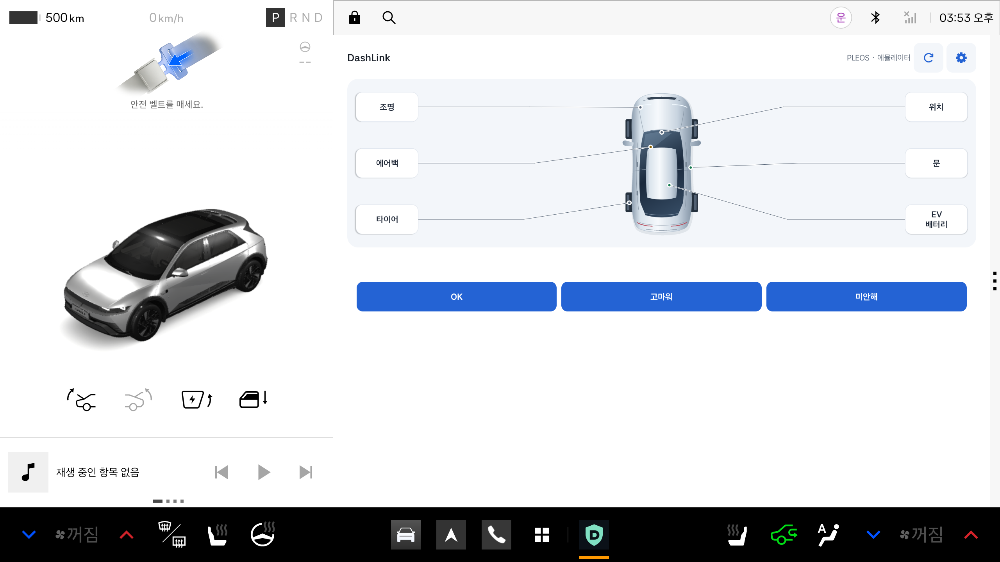

# DashLink

**운전자가 응답하기 어렵고 통신도 끊긴 사고 상황에서, 차량 조명으로 마지막 도움 요청을 전하는 Pleos Connect 앱 시제품입니다.**

현재 버전은 `0.3.9-mvp`입니다. 차량에 설치하는 Android Automotive OS 앱으로, **정차·앱 전경 상태의 Pleos 에뮬레이터 시연**을 제공합니다. 사고와 통신 상태를 모의 입력해 응답 대기부터 SOS 요청까지 체험할 수 있습니다. 119 신고와 보호자 위치 전달은 앱 내부 모의 결과이며 실제 발신·외부 전송은 없습니다.

[Release APK](apk/한원우_DashLink_release.apk) · [시연 영상·화면](submission/README.md) · [검증 결과](docs/validation.md) · [제3자 라이선스](THIRD_PARTY_NOTICES.md)



[SOS 반복 영상 — 0.3.9](submission/DashLink-repeat.mp4) · [반복 대기](submission/screenshots/repeat/01-waiting.png) · [다음 회차](submission/screenshots/repeat/02-repeat.png) · [중지](submission/screenshots/repeat/03-stopped.png)

## 주요 기능

- **사고 대응 시연:** 모의 사고 후 10초 동안 응답을 기다리고, 응답이 없으면 SOS 3회를 한 묶음으로 요청합니다. SDK 출력은 원래 조명 복귀 확인 후 30초 대기하고, 정차·앱 전경·권한·지원·복구 상태를 재검사해 다음 묶음을 시작합니다. 화면 미리보기에도 같은 간격을 적용하며 회차와 대기 시간을 표시합니다. 통신 가능 여부·119 설정·연락처·위치 확보 여부에 따라 모의 결과가 달라집니다.
- **차량 상태 조회:** 공통 차량 그래픽에서 문·타이어·EV 배터리·에어백·조명·위치의 조회 상태를 확인하고 각 부위를 눌러 상세 내용을 봅니다. 초록색은 조회 성공이며 차량의 건강 상태를 진단한 결과가 아닙니다. 타이어 항목은 현재 공기압이 아닌 저압 경고 기준입니다.
- **일회성 메시지:** 홈의 `OK`, `고마워(THANKS)`, `미안해(SORRY)`를 누르면 점·선 패턴이 버튼 아래에 표시됩니다. 한 번 재생한 뒤 종료하며, 실행 중 같은 빨간 버튼을 누르면 중지합니다.
- **안전한 중단·복구:** CarUxRestrictions가 제한하거나 상태를 확인할 수 없으면 동작을 제한합니다. 중지·앱 이탈·주행 제한·조명 오류가 발생하면 반복을 종료하고 자동 재개하지 않습니다. 조명 원상복귀를 확인하지 못하면 SDK 출력을 잠그고, 정차 후 별도 복구 요청과 원래 값 재조회가 성공해야 해제합니다.

SOS의 30초 간격은 한 묶음의 복귀 확인 이후부터 계산하는 **에뮬레이터 시연용 대기 시간**입니다. 실차의 전원·램프 내구성·구조 효과를 검증한 안전 기준은 아닙니다.

## 바로 실행하기

1. 아래 시험 환경의 Pleos AVD를 **Cold boot**로 시작하고 정차 상태로 둡니다. VHAL 시험에는 Quick boot를 사용하지 않습니다.
2. `apk/한원우_DashLink_release.apk`를 내려받아 설치합니다. `adb devices`에서 대상 번호를 확인한 뒤 `<SERIAL>`을 바꿉니다.

```sh
adb -s <SERIAL> install -r apk/한원우_DashLink_release.apk
adb -s <SERIAL> shell am start -W -n ai.pleos.contest.dashlink/.MainActivity
```

3. 긴급연락처 등록, 119 모의 신고 허용, 위치 조회 동의를 차례로 선택합니다. 모두 선택 사항이며 건너뛰어도 홈을 사용할 수 있습니다. 최초 설정을 마치면 다음 실행부터 홈이 열립니다.
4. 홈의 차량 부위를 눌러 조회 결과를 확인하고, 아래 메시지 버튼으로 **화면 미리보기**를 실행합니다. 상단 아이콘으로 새로고침과 설정에 접근합니다.
5. `설정 → 모의테스트 → 통신이 끊긴 사고 → 시험 시작`으로 SOS 흐름을 확인합니다. 10초 내에 응답해 취소하거나, 응답 없이 SOS로 이어지는 과정을 볼 수 있습니다. 한 묶음 완료 뒤 30초 대기와 다음 회차를 확인한 후 고정 중지 버튼으로 종료합니다.
6. SDK 요청을 시험하려면 설정 또는 모의테스트 준비 화면에서 `에뮬레이터 조명`과 지원 조명을 선택합니다. 권한·capability·원래 스위치 상태를 확인한 뒤 요청합니다. 앱 재시작 시에는 화면 미리보기로 돌아갑니다.

조명 복구 안내가 나타나면 정차 후 `조명 복구 → 정차 상태에서 복구`를 실행합니다. 정차만으로 출력이나 신호가 자동 재개되지는 않습니다. debug 빌드와 제출 APK는 서명이 다르므로 서로 업데이트 설치할 수 없습니다. 별도 AVD에서 시험하거나, 조명 복귀 상태를 먼저 확인한 뒤 설치 환경을 정리합니다.

## 시험 환경과 필요한 설정

| 항목 | 구성 |
| --- | --- |
| Pleos Connect 에뮬레이터 | **2.1.0 / API 34 / ARM64**, non-GAS AAOS |
| 기본 화면 | **2560 × 1440 px / 160 dpi**, AVD RAM 4 GB |
| 앱 식별자 | `ai.pleos.contest.dashlink` |
| 제출 버전 | `0.3.9-mvp` / versionCode `11` |
| Pleos SDK | Vehicle `2.3.2`, FusedLocation `1.1.3` |
| 언어·빌드 | Kotlin `2.2.20`, JDK `17`, Gradle `8.13`, AGP `8.11.1` |
| Android 설정 | minSdk `28`, compileSdk/targetSdk `34`, Build Tools `36.0.0` |

현재 두 SDK의 초기화에는 별도 API 키·Client Secret을 사용하지 않습니다. 외부 서버 설정도 없습니다. 차량 권한과 개별 기능 지원 여부는 별도로 확인하며, 일반 Android 휴대전화 에뮬레이터에서는 Pleos 차량 기능을 시험할 수 없습니다.

앱이 직접 요청하는 권한은 `pleos.car.permission`의 `CAR_DOORS`, `CAR_ENERGY`, `CAR_SAFETY`, `CAR_LIGHTS`, `CONTROL_CAR_LIGHTS`, `FUSED_LOCATION`입니다. SDK 서비스 연결 권한은 라이브러리에서 병합됩니다. 위치는 동의한 전경 세션에서만 조회하며, 앱 이탈 시 좌표와 구독을 정리합니다. 등록 연락처는 기기에 암호화 저장하고 설정에서 삭제할 수 있습니다.

Virtual Console을 사용할 때는 다음 포트 연결 후 `http://127.0.0.1:8088/`을 엽니다.

```sh
adb -s <SERIAL> forward tcp:8088 tcp:8088
```

## 소스 빌드

JDK 17, Android SDK Platform 34, Build Tools 36.0.0, Platform Tools를 준비합니다. Android Studio에서 SDK 경로를 지정하거나 로컬 `local.properties`에 `sdk.dir=<Android SDK 절대경로>`를 설정합니다. 첫 빌드는 Gradle·Google Maven·Maven Central·Pleos Maven에 접근할 수 있어야 합니다.

```sh
./gradlew :app:assembleDebug :app:testDebugUnitTest :app:lintDebug :app:assembleRelease
```

debug APK는 `app/build/outputs/apk/debug/app-debug.apk`에 생성됩니다. 서명키와 서명 설정은 포함하지 않으므로 새로 빌드한 release는 unsigned APK입니다. 바로 설치할 서명된 제출본은 위의 `apk/` 경로를 사용합니다. 제3자 구성요소는 [라이선스 문서](THIRD_PARTY_NOTICES.md)를 확인합니다.

## 확인된 범위

반복 순서·대기 및 복귀 중 중지·실패 경로를 추가한 JVM 단위 테스트 **67개가 통과**했습니다. 이 결과는 에뮬레이터나 실차 조명 동작을 대신하지 않습니다.

현재 AVD에서 에어백 capability는 미지원 응답이므로 실제 전개 신호 수신을 검증하지 못했습니다. 조명은 SDK 요청 응답과 원래 스위치 재조회까지 확인했으며, 물리 램프 점멸이나 주변 차량의 수신을 입증한 결과는 아닙니다. 상시 사고 감시·운전자 행동불능 진단·실차 안전 기능·실제 긴급기관 연결은 구현 범위에 포함하지 않습니다.

[검증 문서](docs/validation.md)는 현재 APK의 빌드·설치 결과와 이전 버전에서 확인한 SDK·주행 제한·복구 결과를 구분합니다. [대표 시연 자료](submission/README.md)의 영상에도 촬영 버전을 표시했습니다.
